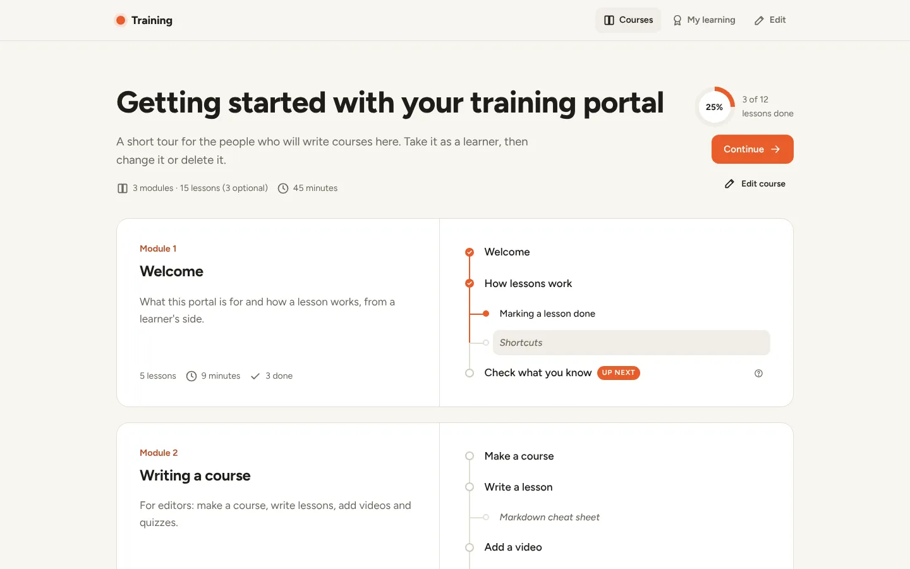
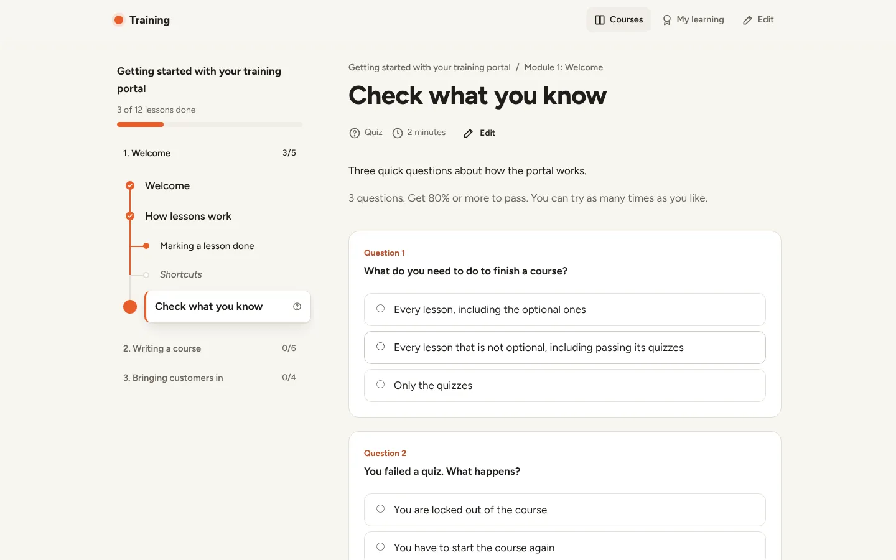
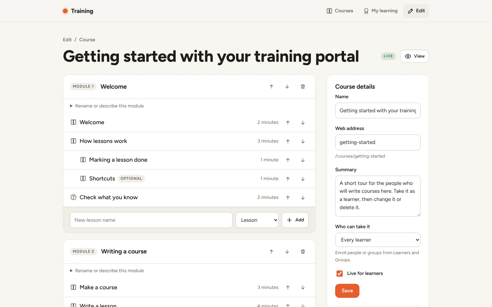
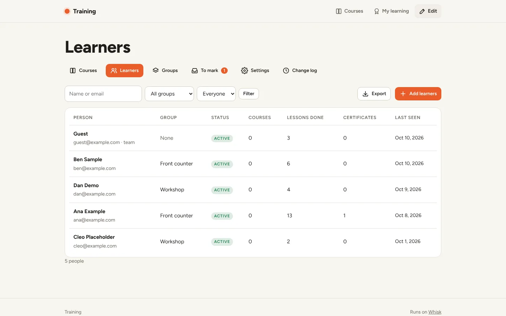
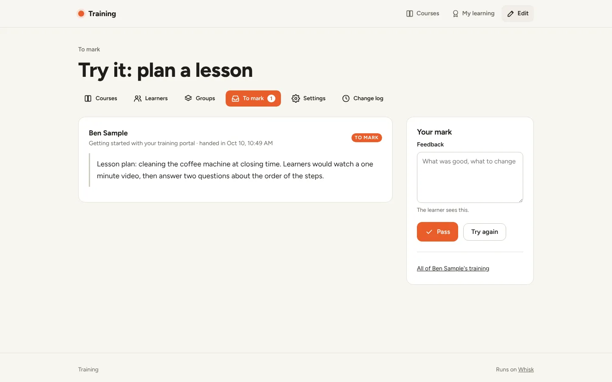
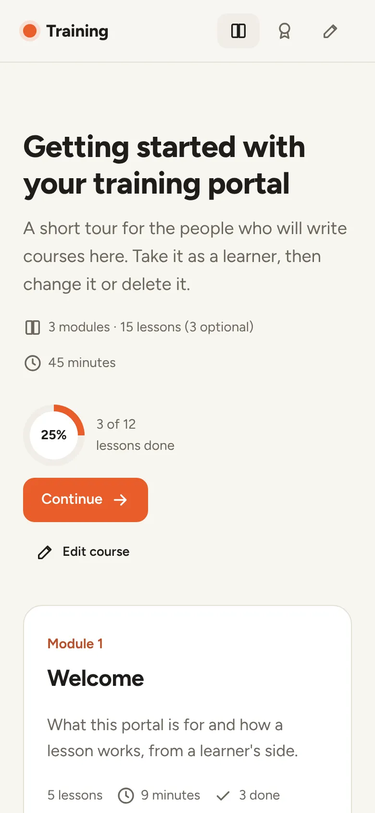
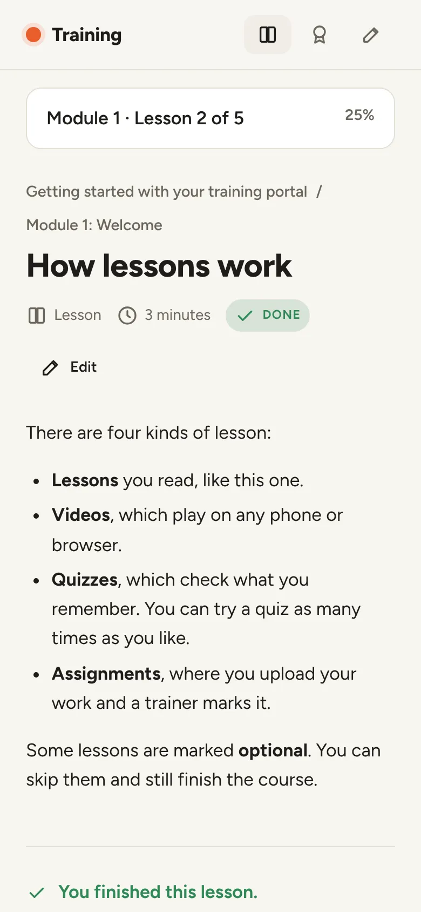

# Training portal

A training portal for your customers: courses made of modules and lessons, with videos, quizzes,
coursework, progress tracking and certificates. It is for any business that teaches its customers
how to get the most out of what it sells.



**[See it live](https://training.examples.whisk.page)**. Press **Look around** to use it as staff. It resets every night.

## Deploy your own

Paste this into Claude Code, Codex, Cursor or any coding agent:

> Read https://whisk.run/skill. Then clone https://github.com/Whisk-Hosting/training-portal, deploy it to Whisk as a new app, and give me its address.

Your agent signs you up to Whisk if you're new, deploys the app, and gives you its address. It comes with sample data so every screen has something to show.

Once it's live, ask your agent to make it yours in plain words, for example:

> Change the name to Maple Street Dental Training and use our logo and blue.
>
> Add a "Company" field when we add learners, and show it in the progress export.
>
> Email me when a learner hands in coursework that needs marking.

Prefer the command line? In a copy of this folder:

```
whisk init --name training
whisk deploy
```

The first deploy adds a sample course that explains how everything works. Open the app, sign in,
and press **Edit**. Set up email under **Edit > Settings**.

## What is Whisk?

[Whisk](https://whisk.run) hosts business apps built with AI coding agents. Your agent creates the account, pushes the app, and it's live at its own address with sign-in, a database, backups, scheduled jobs, email and security already taken care of. This app is one of the [Whisk examples](https://whisk.run/examples): open source, MIT licensed, and yours to change.

## Screenshots

<table>
  <tr>
    <td width="50%"><br>A quiz, with the course outline beside it</td>
    <td width="50%"><br>The course editor</td>
  </tr>
  <tr>
    <td><br>Learners, their groups and progress</td>
    <td><br>Marking coursework</td>
  </tr>
  <tr>
    <td><br>A course on a phone</td>
    <td><br>A lesson on a phone</td>
  </tr>
</table>

## Features

**Courses and lessons**
- Courses are modules of lessons, drawn as a thread. The lesson you are on pops out of the line,
  and finished lessons fill it in.
- A course is open to every learner or only to people enrolled in it, with an optional due date.
- Lessons are written in Markdown, or are a video, a quiz with a pass mark, or an assignment.
- Lessons can be optional. Learners can skip them and still finish.

**Coursework**
- For an assignment, the learner uploads their work and a trainer marks it pass or try again,
  with feedback the learner sees.

**Learners and groups**
- Learners are your customers. Paste a list (email, name, group) to add many at once. Each one
  gets an email with their sign-in link.
- Groups get courses as one.
- Progress exports as CSV.

**Certificates**
- Issued when every required lesson is done.
- Download as a PDF typeset with Typst, with a public link anyone can use to check them.

**Email**
- Goes through Whisk email, from your own domain once it is verified in Whisk.
- Invites, new courses, weekly reminders, certificates and marking news.

**API and webhooks**
- Read or read-and-write keys for `/api/v1`.
- Signed webhooks with retries for invites, enrollments, lessons, quizzes, coursework and
  finished courses.

**Staff and permissions**
- Trainers (developers and the `trainers` group) write courses, add learners and mark work.
- Admins (owners, admins and the `training-admins` group) also change settings, remove people,
  reset progress and read the change log.

## API

Make a key under **Edit > Settings > API and webhooks**, then:

```
curl https://<your app>/api/v1/learners -H "Authorization: Bearer <key>"

curl https://<your app>/api/v1/learners -H "Authorization: Bearer <key>" \
  -H "Content-Type: application/json" \
  -d '{"email": "ana@example.com", "name": "Ana Silva", "courses": ["getting-started"], "due_on": "2026-12-01"}'
```

- The key goes in `Authorization: Bearer <key>`, `X-Api-Key: <key>`, Basic auth with the key as
  the user name, or `?token=<key>`.
- `GET /api/v1` lists every endpoint.
- Errors are `{"error": {"code", "message", "fix"}}`.

Webhook deliveries are JSON POSTs with a `webhook-signature` header:
`t=<unix time>,v1=<hex HMAC-SHA256 of "<t>.<body>" with the webhook's secret>`.

## How it's built

Hono on Node 22, Postgres through `postgres`, Markdown through `marked`, PDFs through Typst, and
no front-end framework. Pages render on the server. The browser script handles uploads, the
Markdown preview, copy buttons and the confetti.

```
src/model.ts         pure decisions: progress, grading, access, due dates, invites, signatures
src/store.ts         one small query per function
src/people.ts        invite, enroll, remove, finish, mark: shared by the pages and the API
src/events.ts        emails and webhooks, written down first, then sent by the queue
src/functions.ts     send-email, deliver-webhook and the daily reminders (Inngest)
src/api.ts           /api/v1
src/routes/          learner pages, course editor, people, settings
src/views/           layout, pages and staff screens, styles, icons, browser script
src/certificate.ts   the PDF certificate
src/demo.ts          the live demo, on only with DEMO=1
demo/                the demo's manifest, its reset graph and npm run deploy:demo
migrations/          plain SQL, run in order by src/migrate.ts before each release
```

Whisk provides sign-in (`X-Whisk-*` headers), the database, uploads and video conversion
(`storage: true`), email (`email: true`), the queue and schedules (`functions`), and customer
invitations (`POST /v1/orgs/<org>/apps/<app>/customers`).

### The live demo

The live demo runs this same app with `DEMO=1`. Anonymous visitors see a **Look around** button,
which signs them in as a guest trainer (a cookie, not a Whisk account). A real sign-in always wins
over the cookie. In the demo:

- Emails and webhooks are recorded and never sent.
- Invites and uploads are refused with an error that says why, and email and webhook settings are
  read-only.
- The guest can make API keys and use them on the sample data.
- Every POST outside `/api/` needs a solved challenge, which the page's script solves. The API
  needs a key instead.
- At 03:00 in New York, `demo-reset` empties the app's tables, keys included, and adds the sample
  data again.

All of it is in `src/demo.ts` and `demo/`. Without `DEMO=1` the demo routes answer 404 and the
cookie is ignored. To deploy the demo, with the demo app named as `<org>/<app>`:

```
WHISK_DEMO_APP=examples/training npm run deploy:demo
```

This copies the app to a temporary folder, uses `demo/whisk.yaml` there as `whisk.yaml`, and
deploys it, so this folder's manifest never changes. A copy that does not want a demo can delete
`src/demo.ts`, `demo/`, the two lines in `src/index.ts` that mention it and the `deploy:demo`
script.

## Run it locally

With Postgres running:

```
npm install && npm run build
DATABASE_URL=postgres://… node dist/migrate.js
DATABASE_URL=postgres://… PORT=8080 WHISK_DEV=1 node dist/index.js
```

With `WHISK_DEV=1` and no Whisk variables, invites, uploads and email are answered locally, so
every screen works. Or `whisk dev --as you@example.com --roles owner`, which also signs you in.

`npm test` runs the unit tests.

## License

MIT
